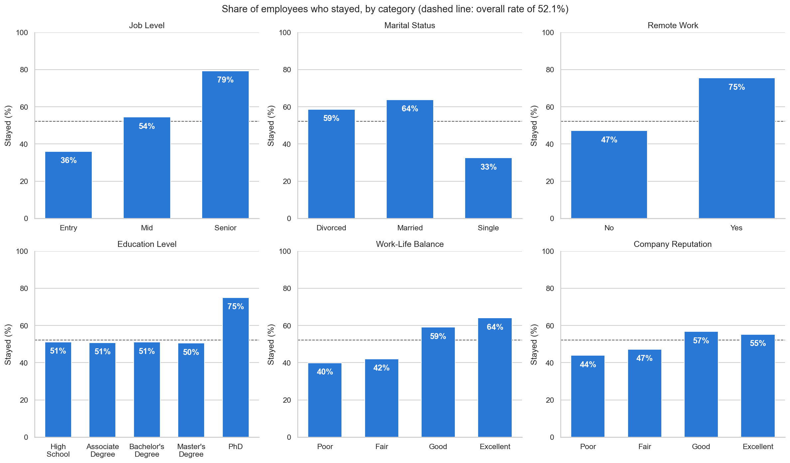
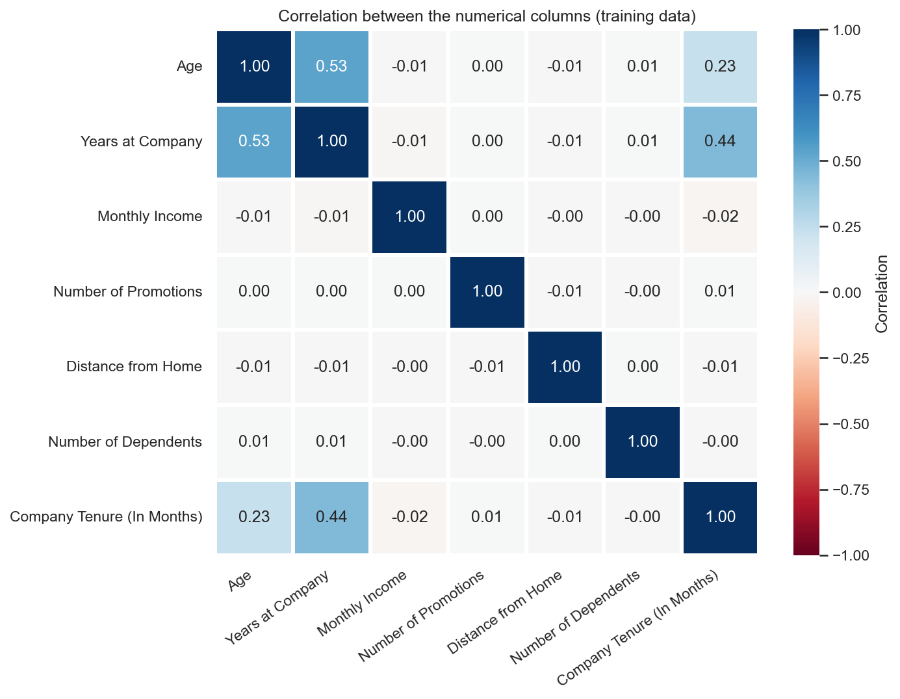
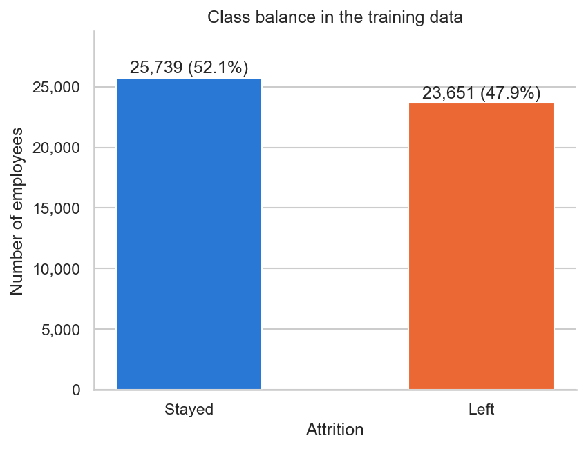
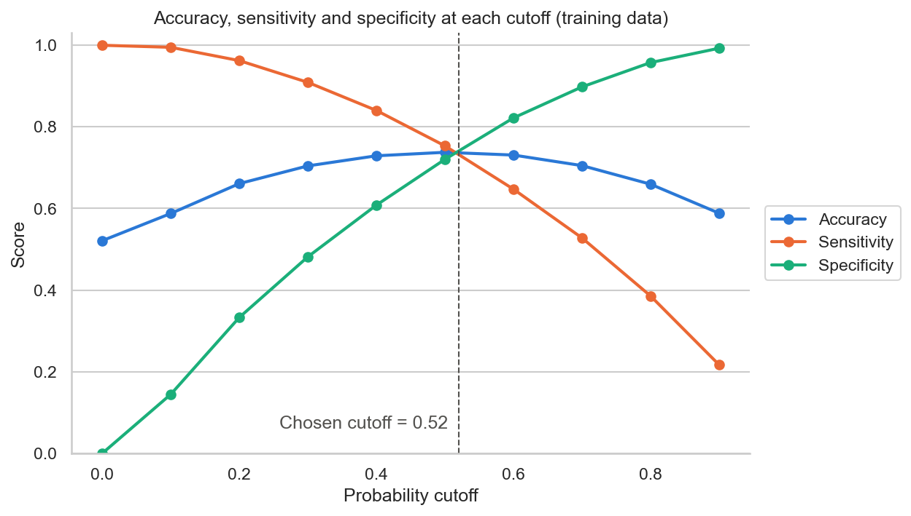
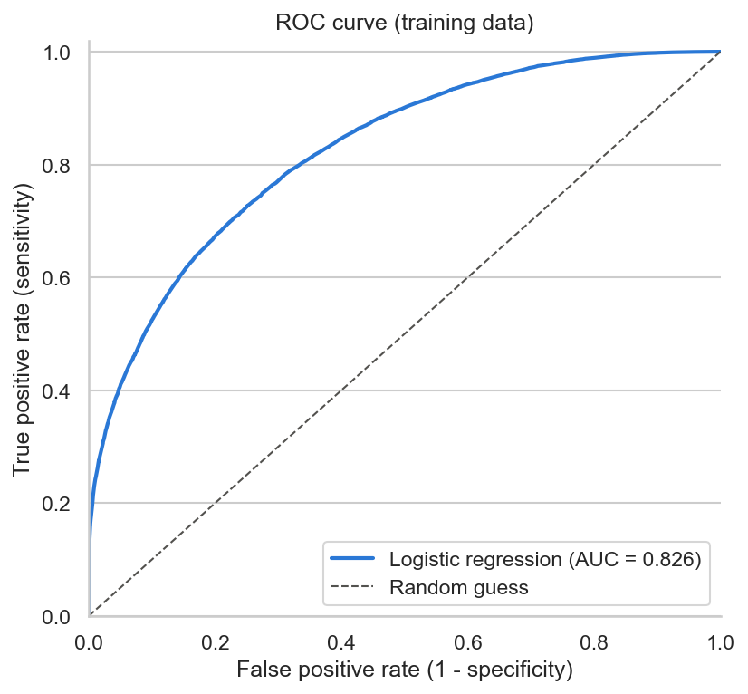
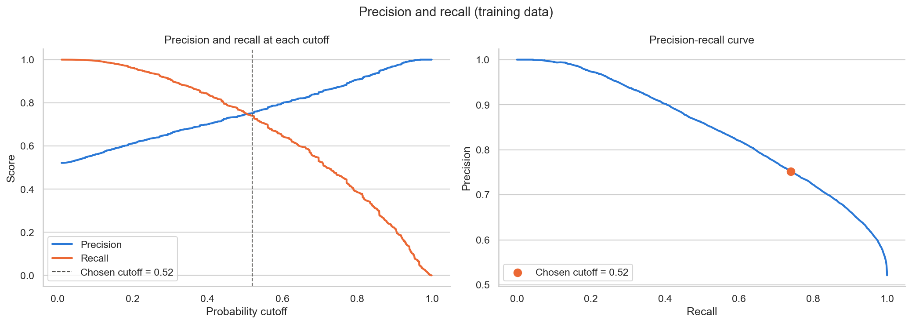
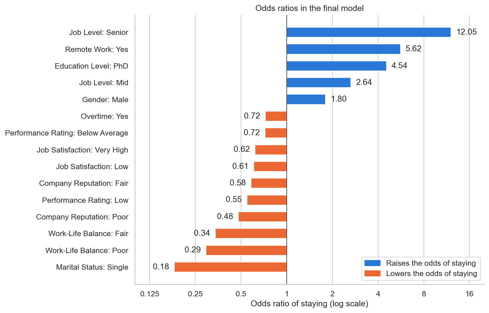

# Predicting Employee Retention

Logistic regression on 74,610 employee records to predict who will stay at a mid-sized
technology company, and to show HR which factors go with staying.

**On 21,168 held-out employees the model recognises 74.0% of those who stayed and 73.9% of
those who left (accuracy 0.739, precision 0.755, AUC 0.825), within about half a point of
its training scores.**

## The problem

The company has mostly dealt with attrition after it happens. It wants to know in advance
who is likely to stay, who is not, and what separates the two groups, so that HR can put
retention effort where it is needed.

That asks two things of a model. It has to rank employees by their chance of staying, so HR
can start with the people least likely to stay. And it has to be explainable, because HR
needs to know what the model is reacting to before acting on it. Logistic regression gives
both: a probability for every employee, and coefficients that turn into odds ratios a
non-specialist can follow.

Stayed is the positive class throughout. Sensitivity is the share of stayers the model
recognises, and specificity is the share of leavers it recognises.

## Data

74,610 employees and 24 columns, covering demographics (age, gender, marital status,
dependents, education), the job (role, level, company size, income, tenure, promotions,
overtime, remote work, distance from home, leadership and innovation opportunities) and
ratings (work-life balance, job satisfaction, performance, company reputation,
recognition). The target is `Attrition`, Stayed or Left.

| Step | Rows | Columns |
|---|---|---|
| Raw | 74,610 | 24 |
| After dropping rows with missing values | 70,635 | 24 |
| After dropping 77 duplicate records | 70,558 | 24 |
| After dropping `Employee ID` | 70,558 | 23 |
| Train / validation (70/30, stratified) | 49,390 / 21,168 | 22 features + target |
| After one-hot encoding | 49,390 / 21,168 | 41 features |

### Cleaning decisions

**Missing values, 3,975 rows.** Only two columns have gaps: Distance from Home (1,912 rows,
2.56%) and Company Tenure (In Months) (2,413 rows, 3.23%). The rows were dropped, which
keeps 94.67% of the data. The gaps are not quite random. Employees with a missing tenure
stayed 62.7% of the time against 52.2% for everyone else, so the drop takes out slightly
more stayers than leavers. Imputing was the alternative, but it would have had to happen
after the split so that the fill values came from training data only. With 70,635 rows
left, dropping was simpler and cost little.

**Garbled text in Education Level.** `Bachelor’s Degree` and `Master’s Degree` are a
curly apostrophe that went through the wrong text encoding (UTF-8 bytes read as
Windows-1252). Replaced with a plain apostrophe. Every categorical column was then checked
for labels that differ only by case or spacing, and there were none.

**77 duplicate records.** Same Employee ID and the same value in every column, so the same
record entered twice. Removed before the split, so no employee can sit in both the training
and the validation set.

**`Employee ID`.** Unique to each employee. Used to confirm the duplicates, then dropped.

**Left alone.** 52 training rows have a monthly income between 50,000 and 50,030, against a
99th percentile of about 12,250, and 17 have 15 dependents when nobody else has more than 6.
They look like placeholder values, but they are 52 and 17 rows out of 49,390, and neither
column makes it into the final model. The data dictionary also uses some level names the
data does not (Below Average and Very Poor where the data has Fair, Very Low where it has
Very High) and describes Overtime as hours when it is Yes/No. The data is consistent with
itself, so the dictionary was treated as out of date.

## What the data says

The share who stayed swings a lot across some categorical features and hardly moves across
others. Ranked by the gap between the highest and lowest level, on the training data, against
an overall rate of 52.1%:

| Feature | Highest level | Lowest level | Gap |
|---|---|---|---|
| Job Level | Senior, 79.3% | Entry, 36.1% | 43.3 pts |
| Marital Status | Married, 63.8% | Single, 32.5% | 31.3 pts |
| Remote Work | Yes, 75.4% | No, 47.1% | 28.3 pts |
| Education Level | PhD, 75.0% | Master's Degree, 50.5% | 24.5 pts |
| Work-Life Balance | Excellent, 64.0% | Poor, 40.0% | 24.1 pts |
| Company Reputation | Good, 56.7% | Poor, 43.9% | 12.8 pts |

At the other end, Job Role (1.6 points), Employee Recognition (2.3), Leadership
Opportunities (3.0), Company Size (3.2) and Innovation Opportunities (3.2) barely move.



Job level is the clearest pattern. Entry-level staff leave far more often than senior staff,
with mid-level staff in between. Remote workers stay much more often than everyone else.
Education only matters at the top: PhD holders stand apart, while the other four levels all
sit at 50 to 51%.

Job Satisfaction does not run in order. Employees with Very High satisfaction stayed 46.6%
of the time, about the same as Low (46.3%) and well below Medium (54.3%) and High (54.7%).
There is no sensible story for that, and it is one of several signs that this is synthetic
data. Another is that 40.0% of employees would have joined the company before the age of
18, with the youngest implied joining age at 8.

### Numerical features



None of the numerical columns says much on its own. The strongest correlation with staying
is Distance from Home at -0.096, then Number of Promotions (0.077) and Number of Dependents
(0.073). Monthly Income is effectively unrelated (0.009). Among themselves, the only real
correlations are Age with Years at Company (0.53) and Years at Company with Company Tenure
(0.44), which is not high enough to treat either column as redundant.

### Class balance



52.1% stayed and 47.9% left. That is close enough to balanced that no resampling was
needed, and accuracy is a fair headline number. Sensitivity and specificity are still
reported throughout, because they show how the model treats each group.

## Feature selection

One-hot encoding the 15 categorical columns, dropping the first level of each, gives 34
dummies, and with the 7 numerical columns that makes 41 features. The numerical columns
were standardised with a scaler fitted on the training data only. RFE with a scikit-learn
logistic regression picked 15 features, and a statsmodels GLM with a binomial family was
then fitted on those 15 for p-values, followed by a VIF check.

The rule was to remove one feature at a time, whichever had a p-value above 0.05 or a VIF
above 5, and refit after each removal. Nothing came close to either threshold.

The final model has 15 features, a maximum p-value of 8.8e-27 and a maximum VIF of 1.84.
They are all dummies: Job Level (Mid, Senior), Remote Work, Education Level (PhD),
Gender (Male), Marital Status (Single), Work-Life Balance (Fair, Poor), Company Reputation
(Fair, Poor), Performance Rating (Low, Below Average), Job Satisfaction (Low, Very High) and
Overtime.

With 49,390 training rows, a p-value below 0.05 is an easy bar to clear, so the VIFs and
the validation results carry more weight here than the significance tests.

RFE kept no numerical column at all. Distance from Home ranked 3rd and Number of Promotions
5th, just outside the cut. RFE removes whichever feature has the smallest coefficient, and a
coefficient on a 0/1 dummy is not on the same scale as one on a standardised column, so the
ranking leans towards dummies and some numerical columns may have been dropped too early.

## Choosing the cutoff



At the default 0.5, sensitivity (0.754) is ahead of specificity (0.720). The curves cross
between 0.5 and 0.6, and a finer search in steps of 0.01 puts the crossing at **0.52**
(sensitivity 0.740, specificity 0.734). Accuracy hardly changes (0.738 at 0.5, 0.737 at
0.52), so moving the cutoff mostly shifts mistakes from one group to the other.

Precision and recall cross at about 0.507, close enough to 0.52 that there was no reason to
adjust it.

The crossover treats the two mistakes as equally costly: telling HR an employee is likely to
stay when they are about to leave, and flagging someone for retention effort who was going
to stay anyway. In practice the first is usually the more expensive one, since replacing a
person costs more than a conversation. With real costs the cutoff would move up, and this
curve is what you would use to move it.



The training AUC is 0.826. Pick one employee who stayed and one who left at random, and the
model gives the stayer the higher probability about 83% of the time.



## Results

### Training set (49,390 employees)

| Cutoff | Accuracy | Sensitivity | Specificity | Precision | Recall | AUC |
|---|---|---|---|---|---|---|
| 0.5 | 0.738 | 0.754 | 0.720 | 0.746 | 0.754 | 0.826 |
| 0.52 | 0.737 | 0.740 | 0.734 | 0.752 | 0.740 | 0.826 |

### Validation set (21,168 employees, cutoff 0.52)

| Accuracy | Sensitivity | Specificity | Precision | Recall | AUC |
|---|---|---|---|---|---|
| **0.739** | **0.740** | **0.739** | **0.755** | **0.740** | **0.825** |

In employee terms: 10,136 of the validation employees left. The model flagged 10,364 people
as likely to leave, of whom 7,492 did leave and 2,872 stayed, so 72.3% of its at-risk list
was right. It missed 2,644 leavers.

## Findings



**Seniority and remote work matter most.** Holding the other features fixed, senior staff
have 12.05 times the odds of staying of entry-level staff, and mid-level staff 2.64 times.
Remote workers have 5.62 times the odds of those who do not work remotely. Remote work is
also the factor here that HR can change most directly, though the limitations below explain
why 5.62 should not be read as cause and effect.

**Work-life balance comes next.** Rating it Fair or Poor cuts the odds of staying to 0.34
and 0.29 of the Good and Excellent groups. Overtime lowers them to 0.72. A Poor or Fair view
of the company's reputation and a weak performance rating push the same way (0.48 to 0.72).

**Some strong predictors are not things HR should act on.** Single employees have 0.18
times the odds of staying of married or divorced ones, and men have 1.80 times the odds of
women. These help the model rank people, but gender and marital status are protected
characteristics in the employment law of many countries. HR can use them to ask why the
experience of work differs between groups. They should never be the basis for treating an
individual differently.

**The model holds up on new data.** Every validation measure is within about half a point of
the training figure at the same cutoff, for example accuracy 0.739 against 0.737 and AUC
0.825 against 0.826. With 49,390 training rows and 15 features there was little room to
overfit, and there is no sign of it.

**Accuracy tops out at about 74%.** At every cutoff checked between 0.4 and 0.6, training
accuracy stays between 0.729 and 0.738. The remaining errors are employees whose recorded
features look like the other group's, and moving the cutoff only trades one kind of error
for the other. Getting past that would take new information about employees or a model that
can pick up interactions.

## Limitations

- The data looks synthetic. 40.0% of employees would have joined before 18, Age and Distance
  from Home are spread almost evenly across their ranges, Monthly Income has placeholder
  values near 50,000, and Very High job satisfaction behaves like Low. The coefficients
  describe this dataset and should not be read as facts about real employees.
- RFE ranks features by coefficient size, which favours dummies over standardised numerical
  columns. Distance from Home, ranked 3rd, may belong in the model.
- Dropping the rows with missing values removed slightly more stayers than leavers, because
  employees with a missing tenure stayed more often (62.7% against 52.2%).
- One random split and no cross-validation. 21,168 validation rows keep the sampling error
  small, but it is still a single split.
- The odds ratios show association, not cause. Remote work may be offered more often to
  people who were already likely to stay, so 5.62 is not a forecast of what extending remote
  work would do.
- The 0.52 cutoff assumes both kinds of mistake cost the same.

## Next steps

- Test the numerical features RFE left out, starting with Distance from Home and Number of
  Promotions, or let cross-validation choose the number of features (RFECV) instead of
  fixing it at 15
- Impute tenure and distance on the training data with a "was missing" flag, since the gaps
  carried some signal
- Set the cutoff from real costs once HR can say what a missed leaver costs compared with an
  unnecessary retention conversation
- Try interaction terms (job level by remote work, for example) or a tree-based model to see
  whether the 74% ceiling moves
- Check calibration, so that a predicted 70% chance of staying means roughly 70% in practice

## Running it

```bash
pip install -r requirements.txt
jupyter notebook Predicting_Employee_Retention_Shubham_Kumar_Singh.ipynb
```

`Employee_data.csv` needs to sit in the same folder as the notebook. Run all cells from top
to bottom; the notebook is sequential and later cells depend on earlier ones. The figures in
this README are written to `images/` as the notebook runs.

---

**Shubham Kumar Singh**, MSc Artificial Intelligence and Computer Science, Northeastern University London

Originally completed as a case study in the upGrad and IIIT Bangalore Data Science Programme.

[LinkedIn](https://linkedin.com/in/shubham-singh-00236a191) · [GitHub](https://github.com/Shubham-afk-del)
